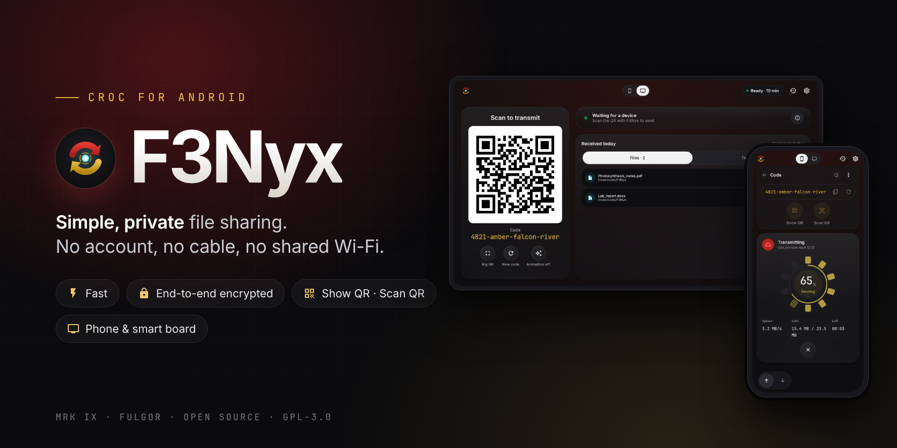
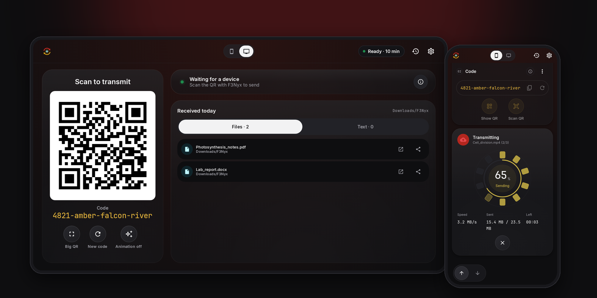
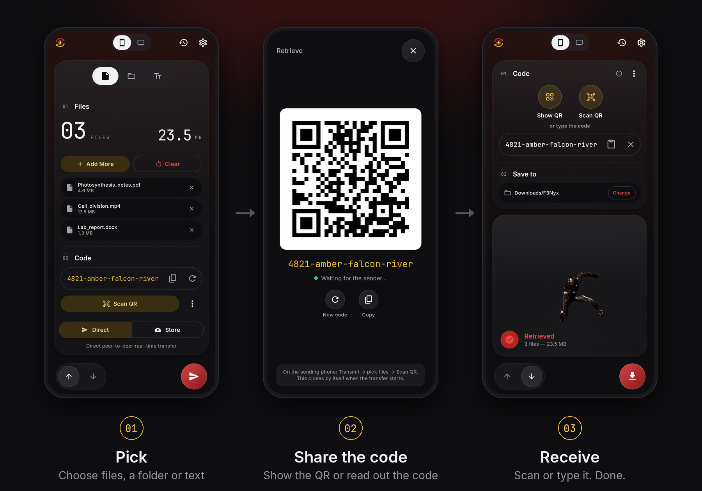
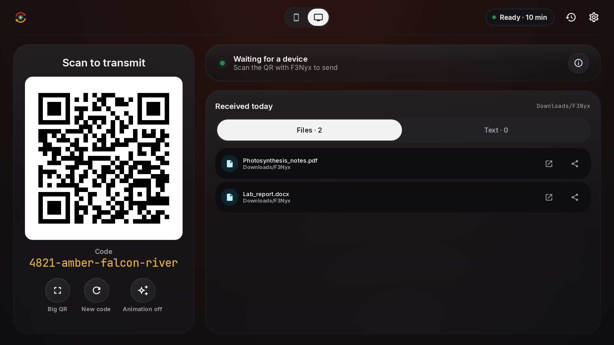
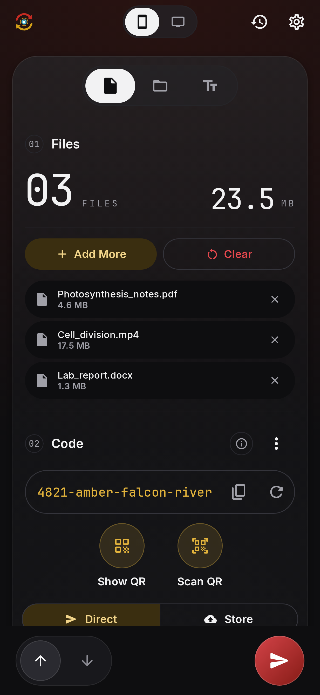
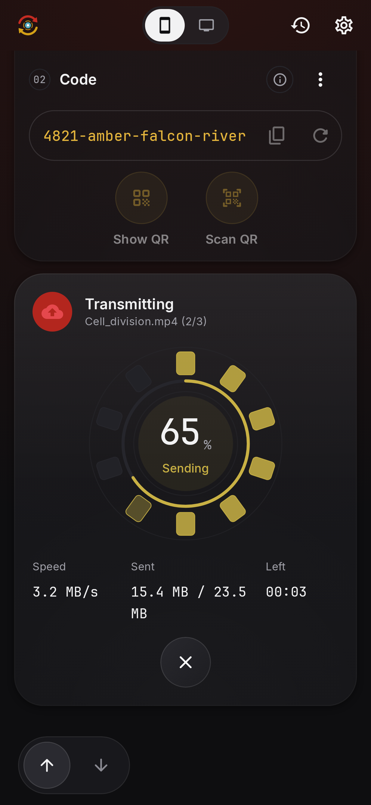
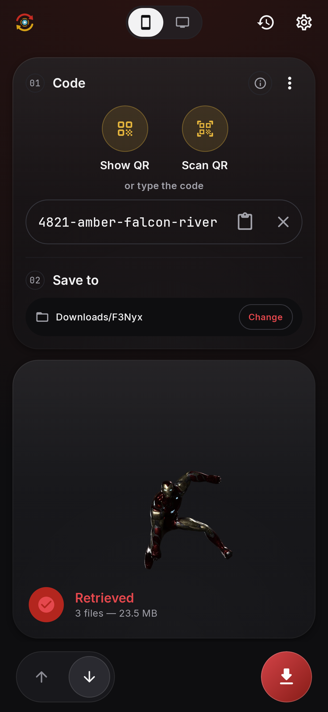
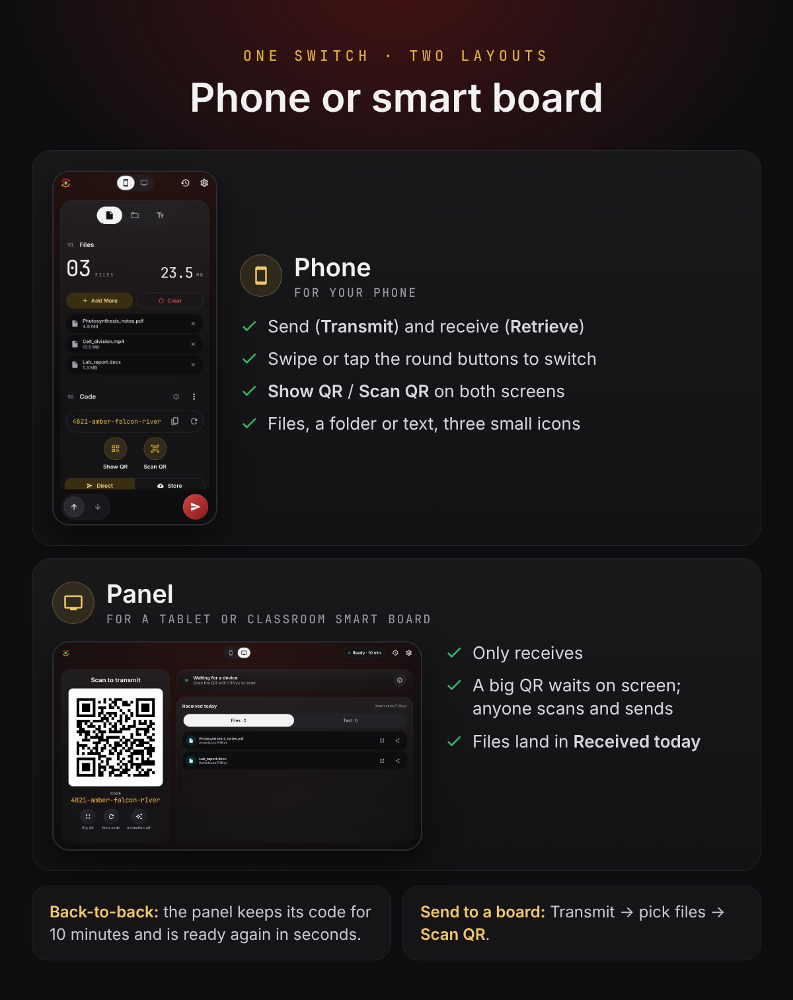
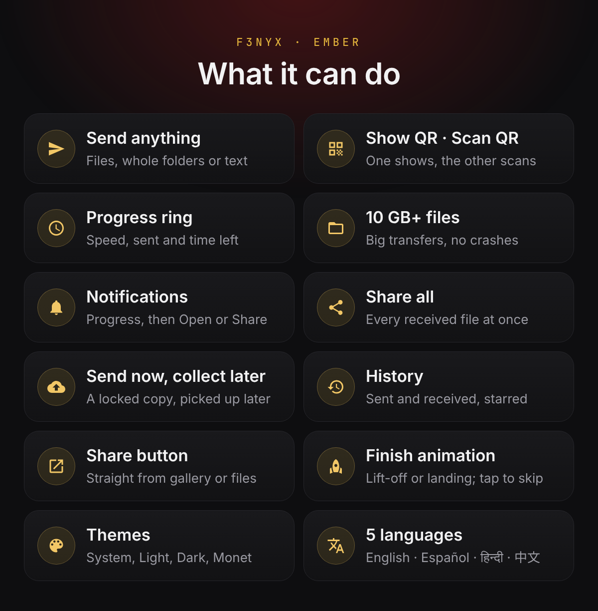
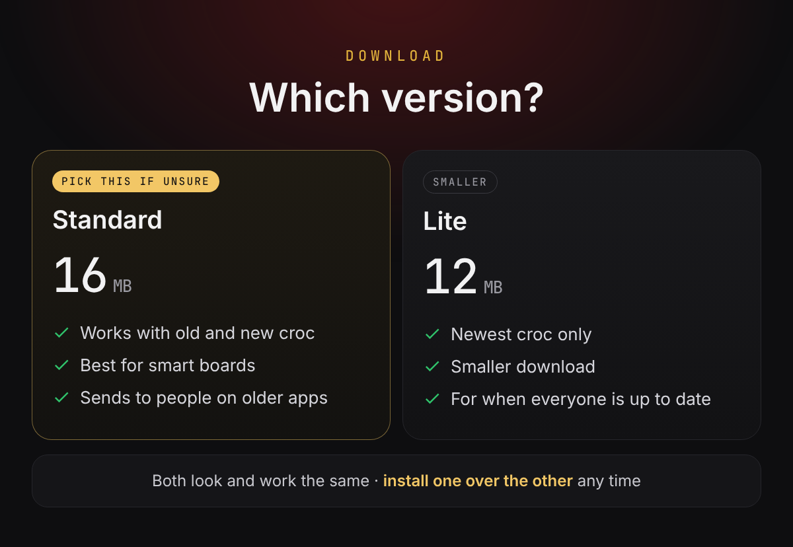

<p align="center">
  
</p>

<h1 align="center">F3Nyx (Phoenix)</h1>

<p align="center">
  <em>Send files from one device to another. Simple and private.</em>
</p>

<p align="center">
  <a href="https://github.com/Dray-Ashcroft/F3Nyx/releases/latest"></a>
  
  
  <a href="LICENSE"></a>
</p>

<p align="center">
  <a href="https://github.com/Dray-Ashcroft/F3Nyx/releases/latest"><strong>Download the app</strong></a>
</p>

<p align="center">
  <a href="#about">About</a> ·
  <a href="#how-it-works">How it works</a> ·
  <a href="#screenshots">Screenshots</a> ·
  <a href="#two-layouts">Layouts</a> ·
  <a href="#what-it-can-do">Features</a> ·
  <a href="#which-version-to-download">Versions</a> ·
  <a href="#install">Install</a> ·
  <a href="#credits">Credits</a> ·
  <a href="#releases">Releases</a> ·
  <a href="#license">License</a>
</p>

---

<p align="center"><em>Project dedicated to Lord Vishnu</em></p>

---

## About

F3Nyx lets you send files, folders or text from one phone, tablet or computer to another. The sender gets a short code or a QR code; the receiver types the code or scans the QR, and the file arrives. You don't need an account, a cable or the same Wi-Fi, and only the two devices can see what is sent.

F3Nyx is built on a free tool called [croc](https://github.com/schollz/croc) and on the Android app made by [Dking08](https://github.com/Dking08). It rose from Kroc-Sauria and Crovan, hence the name: a phoenix.

<p align="center">
  
</p>

<table width="100%">
  <tr>
    <td width="50%" align="center"><b>0</b><br><sub>accounts needed</sub></td>
    <td width="50%" align="center"><b>10 GB+</b><br><sub>files, without crashing</sub></td>
  </tr>
  <tr>
    <td width="50%" align="center"><b>2</b><br><sub>layouts: phone and smart board</sub></td>
    <td width="50%" align="center"><b>5</b><br><sub>languages</sub></td>
  </tr>
</table>

---

## How It Works

<p align="center">
  
</p>

1. **Pick** — choose files, a folder or text on the sending device.
2. **Share the code** — show the QR on either phone, or read out the short code.
3. **Receive** — scan with **Scan QR** or type the code. Done.

---

## Screenshots

<p align="center">
  
  <br><sub><b>Panel layout</b> · smart board, landscape</sub>
</p>

<table width="100%">
  <tr>
    <td width="33%" align="center">
      
      <br><sub><b>Phone layout</b></sub>
    </td>
    <td width="33%" align="center">
      
      <br><sub><b>Transmit</b></sub>
    </td>
    <td width="33%" align="center">
      
      <br><sub><b>Retrieve</b></sub>
    </td>
  </tr>
</table>

---

## Two Layouts

<p align="center">
  
</p>

<sub>Switch layouts with the phone / panel switch in the centre of the top bar.</sub>

<details>
<summary><b>Panel buttons</b></summary>

| Button | What it does |
|:--|:--|
| Big QR | Shows a full-screen QR with the code in large letters, for the back of a classroom |
| New code | Makes a fresh code at once |
| Animation | Turns the finish animation on or off (off by default on panels) |
| i | Shows or hides the three steps for sending to the board |

</details>

---

## What It Can Do

<p align="center">
  
</p>

<sub>Received files are saved in <code>Downloads/F3Nyx</code>.</sub>

---

## Which Version to Download

<p align="center">
  
</p>

---

## Install

1. Download the app file (APK) from [Releases](https://github.com/Dray-Ashcroft/F3Nyx/releases/latest).
2. Open it on your phone and tap **Install**. If asked, allow installing apps from this source.
3. On Android 13 and newer, allow notifications when asked, to see transfer progress.

**Works on:** Android 8 or newer, on most phones made in the last few years. It does not work on very old or 32-bit phones.

**Already have Crovan?** F3Nyx installs as a new app next to it. You can uninstall Crovan once you no longer need its history.

<details>
<summary><b>Why the app asks for permissions</b></summary>

| Permission | Why |
|:--|:--|
| Camera | To scan QR codes |
| Notifications | To show progress and finished transfers |
| Network | To send and receive files |
| Files and photos | To pick files to send and save files you receive |

</details>

<details>
<summary><b>Check your download</b></summary>

Each release has a `SHA256SUMS.txt`. On a computer, compare it with:

```bash
sha256sum F3Nyx-standard-release.apk
```

</details>

---

## For Developers

<details>
<summary><b>Building the app yourself</b></summary>

You need Java 17, Go (version listed in `third_party/croc-src/go.mod`) and Gradle 8.9. Then run:

```bash
gradle assembleStandardRelease assembleLiteRelease
```

- The croc source code is kept in `third_party/`: the current version (11.5.2) and an older one (10.6.0) used only in Standard.
- A test build is made automatically on every update to `master`. Release builds are started by hand from the Actions tab.
- A weekly check updates croc when a new version comes out.

Please read [CONTRIBUTING.md](CONTRIBUTING.md) before contributing. Translations are done on Crowdin.

</details>

---

## Credits

| Contributor | Role |
|:--|:--|
| Sai Prasad, M.Sc. Agri. Entomology, ASRB NET | Project Designer |
| Claude Opus 5.5 | Development |
| OpenAI Astra 6 | Image Generation |
| Dastageer Siddiqui ([Dking08](https://github.com/Dking08)) | Original Android app |
| [schollz](https://github.com/schollz/croc) | croc, the tool that does the sending |

<details>
<summary><b>3D models</b></summary>

| Used for | Model | Creator | Licence |
|:--|:--|:--|:--|
| Finish animation | [Iron-Man Mark 85 \| Rigged](https://sketchfab.com/3d-models/iron-man-mark-85-rigged-dde1085c464d4f8da259fe6669ae4dd2) | 9A Films / Nihar Arora | CC BY 4.0 |
| Switch-screen rings | HUD | anuhya | CC BY 4.0 |

The models were posed and turned into images for the app. See [ASSET_CREDITS.md](ASSET_CREDITS.md).

</details>

<details>
<summary><b>Other software and fonts</b></summary>

| Component | Licence |
|:--|:--|
| croc and the tools it uses | MIT and BSD 3-Clause |
| Inter and JetBrains Mono fonts | SIL OFL 1.1 |
| Android libraries and ZXing (QR scanner) | Apache 2.0 |

</details>

---

## Releases

| Release | Title | Date |
|:--|:--|:--|
| Mrk V | Ember | 23 Nov 2026 |
| Mrk IV | Delta | 27 Oct 2026 |
| Mrk III | Triton | 10 Oct 2026 |
| Mrk II | Requiem | 1 Oct 2026 |
| Mrk I | Dawn | 1 Oct 2026 |

---

## License

F3Nyx is free and open source under the **GNU GPL v3.0** (see [LICENSE](LICENSE)). The croc code in `third_party/` uses the **MIT** licence.

<p align="center">
  <sub>Built on the Android croc app · Powered by croc</sub><br>
  <sub>GitHub · Codeberg</sub>
</p>
