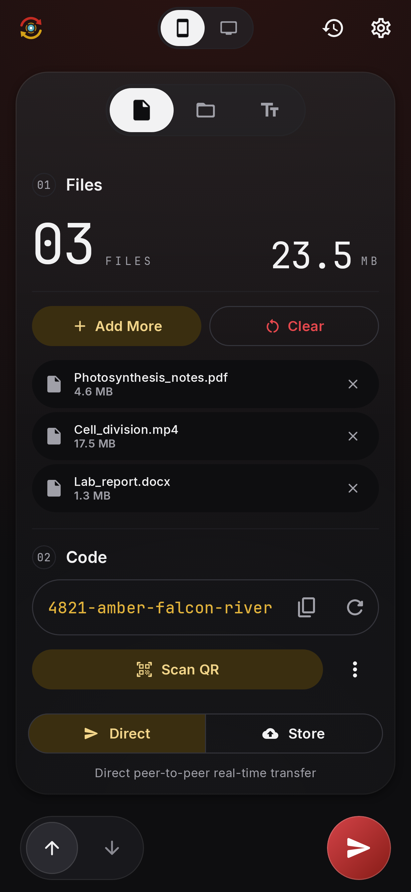

<p align="center">
  
</p>

<h1 align="center">F3Nyx</h1>

<p align="center">
  <em>Send files from one device to another. Simple and private.</em>
</p>

<p align="center"><a href="https://github.com/Dray-Ashcroft/F3Nyx/releases"><strong>Download the app</strong></a></p>

<p align="center">
  <a href="#about">About</a> ·
  <a href="#screenshots">Screenshots</a> ·
  <a href="#two-layouts">Layouts</a> ·
  <a href="#what-it-can-do">Features</a> ·
  <a href="#which-version-to-download">Versions</a> ·
  <a href="#install">Install</a> ·
  <a href="#credits">Credits</a> ·
  <a href="#releases">Releases</a> ·
  <a href="#license">License</a>
</p>

---

<p align="center"><em>Project dedicated to Lord Vishnu</em></p>

---

## About

F3Nyx lets you send files, folders or text from one phone, tablet or computer to another. The sender gets a short code or a QR code; the receiver types the code or scans the QR, and the file arrives. You don't need an account, a cable or the same Wi-Fi, and only the two devices can see what is sent.

F3Nyx is built on a free tool called [croc](https://github.com/schollz/croc) and on the Android app made by [Dking08](https://github.com/Dking08). It was earlier called Kroc-Sauria and then Crovan.

---

## Screenshots

<table width="100%">
  <tr>
    <td width="50%" align="center">
      
      <br><sub><b>1 · Phone layout</b></sub>
    </td>
    <td width="50%" align="center">
      
      <br><sub><b>2 · Panel layout</b></sub>
    </td>
  </tr>
  <tr>
    <td width="50%" align="center">
      
      <br><sub><b>3 · Transmit (Send)</b></sub>
    </td>
    <td width="50%" align="center">
      
      <br><sub><b>4 · Retrieve (Receive)</b></sub>
    </td>
  </tr>
</table>

---

## Two Layouts

The app has two layouts. A small switch in the centre of the top bar, with a phone icon and a panel icon, shows which one you are in.

| Layout | Use it on | What it does |
|:--|:--|:--|
| **Phone** | Your phone | Send (**Transmit**) and receive (**Retrieve**). Tap the round buttons at the bottom or swipe to switch. |
| **Panel** | A tablet or classroom smart board | Only receives. It shows a big QR code so anyone can scan it with their phone and send a file. |

**To change layout:** tap the other icon on the switch. A short switch screen confirms it.
**Back-to-back sending:** the panel keeps the same code for 10 minutes and is ready again within seconds after each file. Your phone remembers the panel, so you can send file after file without scanning again.
**To send to a smart board:** on your phone, open Transmit, tap **Scan panel QR**, then choose the file.

<details>
<summary><b>Panel buttons</b></summary>

| Button | What it does |
|:--|:--|
| Big QR | Shows a full-screen QR with the code in large letters, for the back of a classroom |
| New code | Makes a fresh code at once |
| Animation | Turns the finish animation on or off (off by default on panels) |
| i | Shows or hides the three steps for sending to the board |

</details>

---

## What It Can Do

| Feature | What it means |
|:--|:--|
| **Send** | Send files, whole folders, or a piece of text. Switch between them with three small icons. |
| **Receive** | Scan a QR code or type a code; files are saved in your `Downloads/FeNyx` folder |
| **Progress ring** | A ring fills up and changes from red to yellow to green as the file moves, with speed and time left |
| **Big files** | Large files (10 GB and more) send without the app closing |
| **Notifications** | See progress while a transfer runs, cancel it, and open or share files when they arrive |
| **Share all** | Share every received file at once, or open the Downloads folder |
| **Send now, collect later** | Upload a locked copy that the other person can download later from a link; delete it any time |
| **History** | See what you sent and received, and mark favourites |
| **Share button** | Send straight from your gallery or file manager using Android's Share button |
| **Finish animation** | A short animation plays inside its own card when a transfer finishes. Tap to skip, or turn it off in Settings. |
| **Themes** | System, Light, Dark and Monet, which takes accent colours from your wallpaper |
| **Languages** | English, Español, हिन्दी, 简体中文 and 繁體中文 |

---

## Which Version to Download

| Version | Size | Choose it if |
|:--|:--|:--|
| **Standard** | about 16 MB | You send to people who may have an older app. It works with old and new versions. Best for smart boards. |
| **Lite** | about 12 MB | Everyone has an up-to-date app and you want a smaller download. |

Both look and work the same. You can install one over the other.

---

## Install

1. Download the app file (APK) from [Releases](https://github.com/Dray-Ashcroft/F3Nyx/releases).
2. Open it on your phone and tap **Install**. If asked, allow installing apps from this source.
3. On Android 13 and newer, allow notifications when asked, to see transfer progress.

**Works on:** Android 8 or newer, on most phones made in the last few years. It does not work on very old or 32-bit phones.

**Already have Crovan?** F3Nyx installs as a new app next to it. You can uninstall Crovan once you no longer need its history.

<details>
<summary><b>Why the app asks for permissions</b></summary>

| Permission | Why |
|:--|:--|
| Camera | To scan QR codes |
| Notifications | To show progress and finished transfers |
| Network | To send and receive files |
| Files and photos | To pick files to send and save files you receive |

</details>

---

## For Developers

<details>
<summary><b>Building the app yourself</b></summary>

You need Java 17, Go (version listed in `third_party/croc-src/go.mod`) and Gradle 8.9. Then run:

```bash
gradle assembleStandardRelease assembleLiteRelease
```

- The croc source code is kept in `third_party/`: the current version (11.5.2) and an older one (10.6.0) used only in Standard.
- A test build is made automatically on every update to `master`. Release builds are started by hand from the Actions tab.
- A weekly check updates croc when a new version comes out.

Please read [CONTRIBUTING.md](CONTRIBUTING.md) before contributing. Translations are done on Crowdin.

</details>

---

## Credits

| Contributor | Role |
|:--|:--|
| Sai Prasad, M.Sc. Agri. Entomology, ASRB NET | Project Designer |
| Claude Opus 5.5 | Development |
| OpenAI Astra 6 | Image Generation |
| Dastageer Siddiqui ([Dking08](https://github.com/Dking08)) | Original Android app |
| [schollz](https://github.com/schollz/croc) | croc, the tool that does the sending |

<details>
<summary><b>3D models</b></summary>

| Used for | Model | Creator | Licence |
|:--|:--|:--|:--|
| Finish animation | [Iron-Man Mark 85 \| Rigged](https://sketchfab.com/3d-models/iron-man-mark-85-rigged-dde1085c464d4f8da259fe6669ae4dd2) | 9A Films / Nihar Arora | CC BY 4.0 |
| Switch-screen rings | HUD | anuhya | CC BY 4.0 |

The models were posed and turned into images for the app. See [ASSET_CREDITS.md](ASSET_CREDITS.md).

</details>

<details>
<summary><b>Other software and fonts</b></summary>

| Component | Licence |
|:--|:--|
| croc and the tools it uses | MIT and BSD 3-Clause |
| Inter and JetBrains Mono fonts | SIL OFL 1.1 |
| Android libraries and ZXing (QR scanner) | Apache 2.0 |

</details>

---

## Releases

| Release | Title | Date |
|:--|:--|:--|
| RC V | Ember | 23 Nov 2026 |
| RC IV | Delta | 27 Oct 2026 |
| RC III | Triton | 10 Oct 2026 |
| RC II | Requiem | 1 Oct 2026 |
| RC I | Dawn | 1 Oct 2026 |

---

## License

F3Nyx is free and open source under the **GNU GPL v3.0** (see [LICENSE](LICENSE)). The croc code in `third_party/` uses the **MIT** licence.

<p align="center">
  <sub>Built on the Android croc app · Powered by croc</sub><br>
  <sub>GitHub · Codeberg</sub>
</p>
